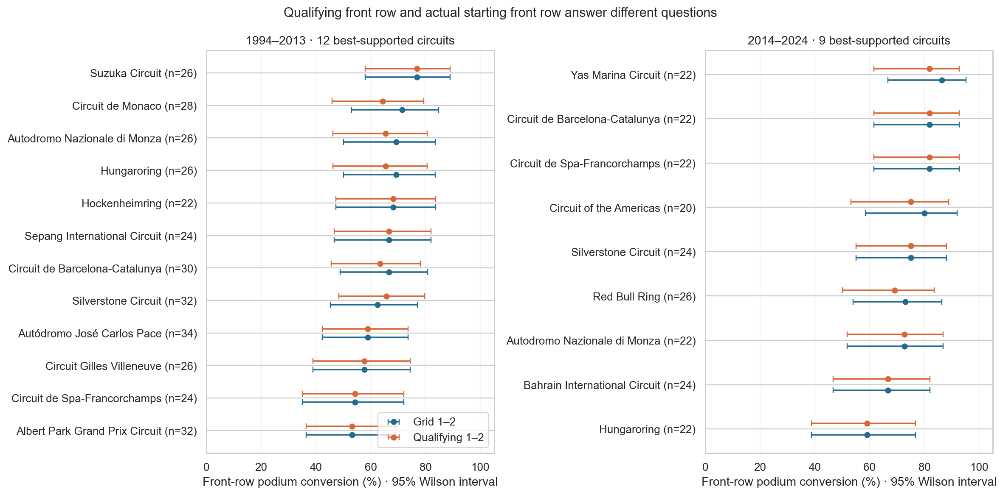
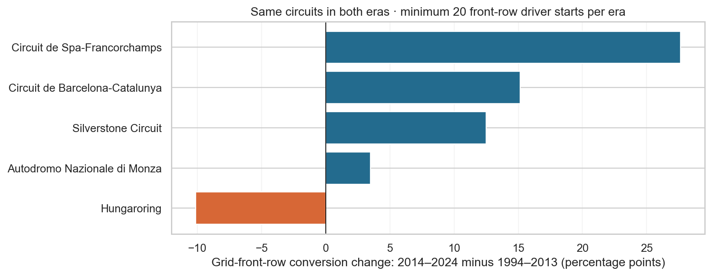
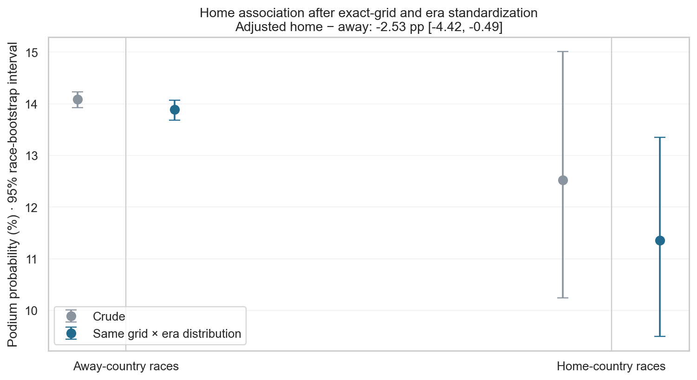
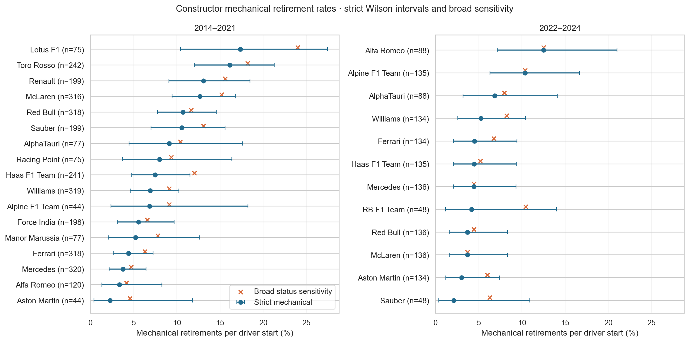
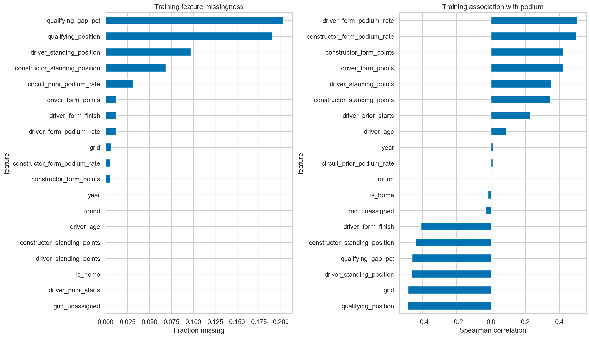
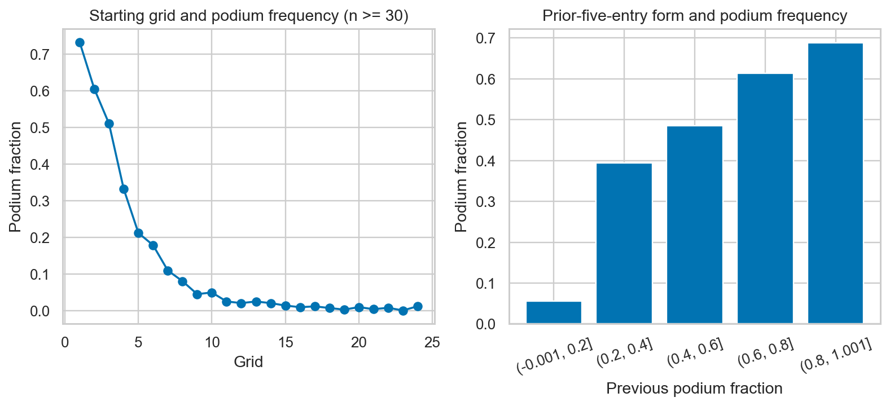

# Formula 1 Podium Prediction: Analytical Report

Generated from the executed notebook: 2026-10-17 13:05 UTC

Target: podium finish (positionOrder <= 3). Prediction cutoff: after qualifying and before race start. Unit: one driver entering one race.

## 1. Answers to the three data-engineering questions

### 1.1 Front-row starts and circuit podium conversion

Qualifying positions 1-2 and final grid slots 1-2 are compared separately because penalties can change the starting grid. The comparison uses 490 races with both definitions observed, excluding 87 races without complete front-row support. Recorded nonstarters are excluded from the start denominator. Circuit-era rankings require adequate support and are descriptive.

Compared 490 races from 1994–2024 with both front-row definitions observed; excluded 87 races with incomplete front-row support. Recorded nonstarters are removed before eligibility is checked (138 driver entries in this window). 1994–2013 Grid 1–2: Suzuka Circuit, 76.9% (20/26); 1994–2013 Qualifying 1–2: Suzuka Circuit, 76.9% (20/26); 2014–2024 Grid 1–2: Yas Marina Circuit, 86.4% (19/22); 2014–2024 Qualifying 1–2: Circuit de Barcelona-Catalunya, 81.8% (18/22). The largest supported absolute grid-conversion change is Circuit de Spa-Francorchamps: +27.7 percentage points; its common-circuit rank changed from 5 to 1. Front-row membership differs for 72 driver-race records, so qualifying and grid must not be conflated. Ranks are descriptive, with ties and wide intervals possible; changes cannot be attributed causally to hybrid regulations.

**Figure 1. Circuit podium conversion from qualifying and actual grid front rows, with uncertainty intervals.**

**Figure 2. Change in front-row conversion across the 2014 era boundary for circuits with common support.**

### 1.2 Home-country podium association after grid control

Home-country status is based on an explicit mapping from recorded driver nationality to circuit country. Home and away rates are standardized over the same observed exact-grid-position by era strata. Whole races are resampled for uncertainty, preserving dependence among competitors. This controls observed starting position and broad era, not driver or team strength.

In 1994–2024, crude home podium rate is 12.5% versus 14.1% away. After standardizing exact grid × era, home is 11.4% versus 13.9% away: difference -2.53 percentage points (95% race-bootstrap interval -4.42 to -0.49). Shared support retains 11,043/12,358 rows (89.4%) across 40 strata; 0 rows are excluded for unavailable mapping/country/grid. The unit is a driver entry; recorded nonstarters remain non-podiums for this pre-race association. 964/1,000 adjusted bootstrap draws retained all strata. The adjusted interval excludes zero, supporting an observed association in this target population. Nationality is a proxy for home, and unmeasured driver/team/circuit differences prevent causal interpretation.

**Figure 3. Crude and grid/era-standardized home and away podium rates with race-bootstrap intervals.**

### 1.3 Constructor mechanical retirements by era

The denominator is race starts; the numerator requires an explicit mechanical component cause and fewer recorded laps than the winner as an early-end proxy. Crash, driver-caused, and regulatory outcomes are excluded from the mechanical numerator. Positive-lap withdrawals remain starts. Strict and broader cause maps are compared for 2014-2021 and 2022-2024.

2014–2021: Lotus F1 has the highest supported strict rate, 17.3% (13/75), 95% Wilson interval 10.4%–27.4%; the broad-map leader is Lotus F1 (24.0%); 2022–2024: Alfa Romeo has the highest supported strict rate, 12.5% (11/88), 95% Wilson interval 7.1%–21.0%; the broad-map leader is Alfa Romeo (12.5%). Excluded 28 recorded nonstarters from both numerator and denominator. Withdrawal/nonqualifying labels exclude only entries without positive laps; positive-lap withdrawals remain starts. Both cause maps require laps below winner distance as an early-end proxy; 1 full-distance component-status row(s) are flagged and excluded from both retirement numerators, while remaining in the start denominator. 10 remaining zero-lap mechanical/ambiguous rows have uncertain start status; the exported table reports a sensitivity excluding these. The numerator excludes explicit crash/damage, driver-health and regulatory outcomes while these started entries remain in the denominator. Rankings use at least 40 starts and recorded constructor IDs, so a rename does not automatically inherit its predecessor's rate. Wilson intervals and unequal exposure mean that the largest observed rate is not necessarily evidence of the least reliable constructor.

**Figure 4. Constructor mechanical-retirement rates by era, with strict and broad definitions and uncertainty intervals.**

## 2. Selected features and pre-race validity

The prediction cutoff is after qualifying and before the race starts. Every selected predictor is available by that cutoff or is derived solely from completed earlier races. Current-race results, points, status, laps, pit stops, and post-race standings are excluded. Driver and constructor histories are shifted so the current race cannot contribute to its own features.

Feature selection combines training-period exploratory evidence with domain reasoning. The table lists every selected input, its motivation, and the information available at the cutoff. The accompanying figures show training-only associations and feature effects; these are exploratory evidence, not causal effects or proof that a feature improves the final model.

### Selected feature rationale and cutoff availability

| feature | group | motivation | availability |
| --- | --- | --- | --- |
| grid | Grid | Starting opportunity is expected to constrain podium chances. | Final published starting grid before race start; zero is treated as missing. |
| grid_unassigned | Grid | Distinguishes pit-lane/unrecorded grid from an ordinary midfield start. | Final published starting grid before race start; zero is treated as missing. |
| qualifying_position | Qualifying | Reflects weekend pace while allowing penalties to change the actual grid. | Current qualifying positions and completed qualifying lap times before start. |
| qualifying_gap_pct | Qualifying | Normalizes lap duration across circuits, while acknowledging session-condition differences. | Current qualifying positions and completed qualifying lap times before start. |
| driver_form_podium_rate | Form | Recent results summarize competitiveness using only completed races. | Only earlier completed Grand Prix results; driver entry rolling mean and team race aggregation shifted once. |
| driver_form_points | Form | Provides a graded recent-performance measure beyond a binary podium. | Only earlier completed Grand Prix results; driver entry rolling mean and team race aggregation shifted once. |
| driver_form_finish | Form | Adds recent finishing consistency, including non-podium outcomes. | Only earlier completed Grand Prix results; driver entry rolling mean and team race aggregation shifted once. |
| driver_prior_starts | Form | Represents experience and distinguishes debut from a missing form value. | Only earlier completed Grand Prix results; driver entry rolling mean and team race aggregation shifted once. |
| constructor_form_podium_rate | Form | Captures recent team strength without leaking a current-race teammate outcome. | Only earlier completed Grand Prix results; driver entry rolling mean and team race aggregation shifted once. |
| constructor_form_points | Form | Summarizes recent team competitiveness without favoring larger historical lineups. | Only earlier completed Grand Prix results; driver entry rolling mean and team race aggregation shifted once. |
| driver_standing_points | Standings | Summarizes current-season performance available before the current race. | Snapshot after previous Grand Prix in same season; round one has zero points and missing rank. |
| driver_standing_position | Standings | Adds relative current-season competitiveness alongside absolute points. | Snapshot after previous Grand Prix in same season; round one has zero points and missing rank. |
| constructor_standing_points | Standings | Represents accumulated team strength before the current race. | Snapshot after previous Grand Prix in same season; round one has zero points and missing rank. |
| constructor_standing_position | Standings | Adds the team's relative position under the current scoring system. | Snapshot after previous Grand Prix in same season; round one has zero points and missing rank. |
| driver_age | Context | Exploratory experience/context hypothesis, tested by context ablation. | Scheduled year/round, birth date, sporting nationality/circuit country, and earlier circuit races. |
| is_home | Context | Tests the observed home-country association without treating it as causal. | Scheduled year/round, birth date, sporting nationality/circuit country, and earlier circuit races. |
| circuit_prior_podium_rate | Context | Historical field-size/circuit context is an exploratory hypothesis. | Scheduled year/round, birth date, sporting nationality/circuit country, and earlier circuit races. |
| year | Context | Represents broad eras and scoring/format changes, with extrapolation limits. | Scheduled year/round, birth date, sporting nationality/circuit country, and earlier circuit races. |
| round | Context | Allows season progression to modify other competitiveness signals. | Scheduled year/round, birth date, sporting nationality/circuit country, and earlier circuit races. |

**Figure 5. Training-only missingness and univariate association evidence for selected features.**

**Figure 6. Observed feature effects and podium rates used to motivate feature groups.**

## 3. Known limitations

Historical qualifying coverage is sparse and uneven. Analyses that require qualifying data use supported periods and common coverage, while the modeling sensitivity compares a shorter training window. Historical coverage and timing conventions may still change the observed relationships.

Formula 1 rules, cars, calendars, scoring systems, constructor identities, and field composition change across eras. The 2014 boundary is a useful descriptive comparison, not an isolated causal experiment. A model trained on past seasons may transfer poorly after regulatory changes or to new drivers and teams.

The archived final grid is treated as information available before the race. The archive does not provide a publication timestamp for every grid update; live use requires a genuine pre-start snapshot. Historical form and standings are only valid when constructed from completed earlier races.

Home-country status is a nationality-based proxy, not residence or personal identification. The three data-engineering analyses are observational; unmeasured driver, team, circuit, and selection differences remain. Mechanical retirement labels and recorded lap counts are imperfect proxies, and constructor IDs do not automatically unify renamed teams.

These limitations constrain interpretation and transfer. Plots and feature associations describe the supplied archive; they do not establish causes or guarantee future prediction performance.
